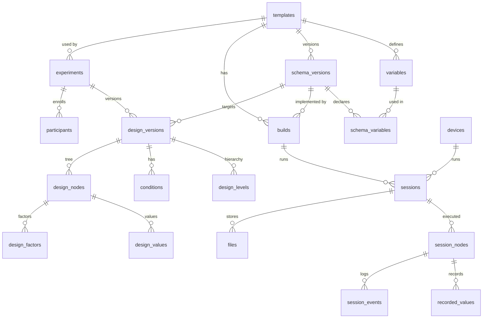

# DelverLab — Architecture & Initial Data Model

> Status: **draft / starting point**. Decisions here are expected to change as the project evolves.

DelverLab is an open-source, self-hostable platform to **design experiments centrally and run them on devices**. It starts with XR experiments built in Unity (LabCG), but the model is not XR-specific.

- **Scientists** define experiments in the web app: variables, conditions, hierarchy, values, surveys.
- **Developers** build the experience in Unity using the DelverLab SDK, against a pinned schema.
- **Devices** (e.g. Meta Quest) receive a session plan, run it (online or offline) and upload the results.

---

## 1. Context — what already exists

| Tool | What it does | Gap for us |
|---|---|---|
| [UXF](https://github.com/immersivecognition/unity-experiment-framework) | Unity Session → Block → Trial, cascading settings, trackers, CSV output, HTTP POST handler | Fixed 3-level hierarchy, settings are local JSON, no central platform, built-in UI doesn't work on standalone headsets |
| [bmlTUX](https://github.com/BioMotionLab/TUX) | Unity GUI for variables, counterbalancing, randomization | Design lives inside Unity |
| [VERA](https://sreal.ucf.edu/vera/) | Hosted platform: web app + Unity plugin, remote WebXR studies | Not open source (as far as we found), not self-hostable, WebXR only, remote-first |
| Ouvrai | Open-source remote WebXR studies (Firebase) | Not Unity / native |
| Ubiq-exp | Unity toolkit for remote/distributed experiments | No central design platform |
| PLUME | Record / replay XR sessions | Recording, not design or delivery |
| JATOS, Pavlovia | Self-hosted / hosted servers for web experiments | Web only |

**DelverLab's position:** open source, self-hosted, native Unity (later other clients), server-defined experiments with a flexible hierarchy, offline-capable devices, in-lab first.

---

## 2. Core concepts

| Concept | Meaning | Who owns it |
|---|---|---|
| **Template** | A kind of task, e.g. `pick_and_place`. Groups schema versions and builds. | Scientist + developer |
| **Variable** | A named thing that can vary or be measured (`time_limit`, `correct`). Stable identity. | Scientist |
| **Schema version** | The set of variables a template exposes at a given version, with types, defaults, constraints, owner. *The knobs of the instrument.* | Scientist, published |
| **Build** | A Unity build implementing exactly one schema version. *The instrument.* | Developer |
| **Experiment** | A study using a template. | Scientist |
| **Design version** | How the study uses the schema: hierarchy, values, conditions, ordering, factors, surveys. Targets one schema version. *The score.* | Scientist |
| **Session plan** | The fully resolved tree for one participant (condition picked, factorials expanded, shuffled with a seed). Frozen. *One performance.* | Generated by the server (or device, offline) |
| **Session** | What actually happened: executed nodes, recorded values, events, files. | Device |

### 2.1 Flexible hierarchy

The hierarchy is **defined by the design**, not fixed. A design declares its levels (e.g. `session > phase > round > trial`), and the deepest level is the **leaf**, where the task runs and results are recorded. The build is **level-agnostic**: changing the hierarchy never requires a rebuild.

### 2.2 Cascading values

Values can be set at any node. When a leaf asks for a variable, the lookup walks up the tree; the **deepest value wins**:

```
trial → round → phase → session → condition value → schema default
```

Condition-specific values beat general values at the same node.

### 2.3 Ownership of values

Each variable in a schema version has an **owner**:

| Owner | Who sets it | Validation |
|---|---|---|
| `server` | The design (web app) | Strict: type, constraints, compatibility |
| `build` | Hardcoded in the build | Recorded; not controlled by the server |
| `runtime` | Computed live (e.g. adaptive staircase) | Recorded with `planned_value` if it differs |

**Principle: control is optional, recording is mandatory.** Every value actually used is stored with its `source`.

### 2.4 Variation in a design

| Variation | Resolved |
|---|---|
| Between-subject conditions | Server, balanced assignment at session creation |
| Order of nodes (counterbalancing, Latin square, random) | Server, seeded |
| Trial lists (factorial expansion) | Server, seeded |
| Adaptive values | Build at runtime, logged |

**Counterbalancing**: varying the order of conditions across participants so learning / fatigue / carry-over effects cancel out.

---

## 3. Versioning & compatibility

### 3.1 Variable edits

| Edit | Example | Effect |
|---|---|---|
| Cosmetic | label, description | Edit in place |
| Behaviour | default, constraints, owner, required | New **schema version** |
| Meaning / identity | key, kind, data type, unit | **Never edited** — create a new variable (optionally `replaces_variable_id`) |

Published schema versions are **immutable**. Recorded values are **never** rewritten.

### 3.2 Developer workflow

- The Unity project pins a schema version in `schema.lock.json` (committed to git).
- The editor plugin generates typed C# classes from the pinned version.
- New schema versions show a **diff** in Unity; upgrading is explicit. Breaking changes surface as compile errors.
- At build time the editor is always online: it verifies the pinned version/hash and registers the build (`builds.schema_version_id`).

### 3.3 Designs

- A design version targets **exactly one** schema version.
- Value-only changes → new design version on the same schema, **no rebuild**.
- Migrating to a new schema creates a new design version (`based_on_id`), re-validated.
- The experiment has an **active design version**; new sessions use it unless another is chosen.
- **Runnable rule:** `design.schema_version_id == build.schema_version_id`.
- Optional `schema_versions.expected_levels` declares the hierarchy a build expects (when the build reacts to level names); designs are checked against it.

---

## 4. Unity SDK (v1 scope)

- Receives a session plan and walks the tree.
- **Layer 1 lifecycle hooks only** (design-configured actions are future work):
  - `OnNodeBegin(node)` / `OnNodeEnd(node)` — awaitable, called for every node.
  - `Run(leaf)` — the task, with typed `Params` / `Results`.
  - Node exposes `Level`, `Name`, `Depth`, `IsLeaf`, `Index`, `Count`, resolved `Params`.
- Transition content can be driven by ordinary server-owned variables (e.g. `block_intro_text`).
- Trackers (position/rotation etc.) write per-leaf files.
- Begin/end timestamps of every node are recorded automatically.

---

## 5. Offline-first devices

The device never *needs* the network to run a session.

### 5.1 Plan sources (`sessions.plan_source`)

| Source | Description |
|---|---|
| `live` | Plan requested from the server at session start |
| `ticket` | Pre-allocated session reserved by the device while online (keeps counterbalancing and participant IDs correct) |
| `embedded` | Design snapshot baked into the build; plan generated locally |
| `build` | Build-owned session, no server design |

### 5.2 Results

- Write locally first, after **every leaf**; then queue in an **outbox**.
- IDs for sessions, nodes, events and files are **UUIDs generated on the device** → idempotent uploads.
- Files are uploaded with SHA-256, chunked/resumable; local copies deleted only after server confirmation.
- Fallback: **export package** (USB) that the server can import.

### 5.3 Plan generation exists twice

Plans are generated in **Java** (server) and **C#** (device, embedded). Both must pass shared **test vectors** (`design + seed + condition → expected plan`) and use the same deterministic PRNG (documented algorithm, never `Math.random` / `UnityEngine.Random`).

---

## 6. System architecture

### 6.1 Repositories

| Repo | Content |
|---|---|
| `delverlab-server` | Spring Boot + PostgreSQL. API, plan engine, handshake, tickets, upload ingestion, exports. |
| `delverlab-web` | Web app for scientists / researchers |
| `delverlab-unity-sdk` | UPM package: runtime + editor plugin (connect, pin, codegen, build hook) |
| spec (folder or repo) | JSON Schemas for template schema, design, session plan, upload payload + test vectors |

### 6.2 Server stack

| Concern | Choice |
|---|---|
| Runtime | Spring Boot 4, Java toolchain per `build.gradle.kts` |
| Database | PostgreSQL 15+ (uses `NULLS NOT DISTINCT`, `gen_random_uuid()`, `jsonb`) |
| Migrations | Flyway |
| Data access | JPA for simple entities; JdbcTemplate / jOOQ where `jsonb`, recursive CTEs or generated columns are involved |
| Auth | Spring Security (JWT) for people; device keys / device tokens for headsets; Keycloak/SSO later |
| File storage | `BlobStorage` interface: **local filesystem** (default) or **S3-compatible** (Garage recommended; SeaweedFS / university Ceph also work). MinIO not used (community edition archived). |
| Live status | SSE |
| API contract | OpenAPI → generated TS client (web) and C# client (Unity) |
| Deployment | Docker Compose: `postgres` + `delverlab-server` (+ optional `garage`) |

### 6.3 Storage keys

```
sessions/{session_id}/nodes/{node_id}/trackers/{tracker}.csv.gz
sessions/{session_id}/other/{name}
exports/{export_id}.zip
```

Metadata (size, sha256, owner) lives in Postgres (`files`); storage only holds bytes.

---

## 7. Database model (initial)

### 7.1 Overview



Three layers:

| Layer | Question | Tables |
|---|---|---|
| Definitions | What can exist? | `templates`, `variables`, `schema_versions`, `schema_variables`, `builds` |
| Design | What should happen? | `experiments`, `design_versions`, `design_levels`, `conditions`, `design_nodes`, `design_values`, `design_factors` |
| Execution | What did happen? | `sessions`, `session_nodes`, `recorded_values`, `session_events`, `files` |

The design layer is optional for a session; the execution layer is always filled.

### 7.2 Values storage

Variables are user-defined, so values are stored as rows with a `jsonb` value. The variable's `data_type` gives the type; generated `value_num` / `value_text` columns keep filtering and aggregation fast. Every leaf stores its **resolved** values (even inherited ones) so each trial row is self-contained.

### 7.3 SQL

```sql
-- ═══════════════════════ ENUMS ═══════════════════════
create type variable_kind  as enum ('parameter', 'result', 'participant');
create type data_type      as enum ('int', 'float', 'bool', 'text', 'enum', 'vector3', 'json');
create type value_owner    as enum ('server', 'build', 'runtime');
create type schema_status  as enum ('draft', 'published');
create type node_control   as enum ('server', 'build');
create type ordering       as enum ('fixed', 'random', 'counterbalance', 'latin_square');
create type plan_source    as enum ('live', 'ticket', 'embedded', 'build');
create type value_source   as enum ('server', 'build', 'runtime', 'default');
create type file_status    as enum ('pending', 'complete');

-- ═══════════════════════ DEFINITIONS ═══════════════════════
create table templates (
  id         uuid primary key default gen_random_uuid(),
  key        text unique not null,             -- 'pick_and_place'
  name       text not null,
  created_at timestamptz not null default now()
);

create table variables (
  id                   uuid primary key default gen_random_uuid(),
  template_id          uuid not null references templates on delete cascade,
  key                  text not null,          -- immutable
  kind                 variable_kind not null, -- immutable
  data_type            data_type not null,     -- immutable
  unit                 text,                   -- immutable
  label                text,                   -- editable
  description          text,                   -- editable
  replaces_variable_id uuid references variables,
  unique (template_id, key, kind)
);

create table schema_versions (
  id              uuid primary key default gen_random_uuid(),
  template_id     uuid not null references templates on delete cascade,
  version         int  not null,
  status          schema_status not null default 'draft',
  hash            text,                        -- set on publish
  expected_levels text[],                      -- null = any hierarchy
  created_at      timestamptz not null default now(),
  published_at    timestamptz,
  unique (template_id, version)
);

create table schema_variables (
  schema_version_id uuid references schema_versions on delete cascade,
  variable_id       uuid references variables on delete restrict,
  owner             value_owner not null default 'server',
  required          bool not null default false,
  default_value     jsonb,
  constraints       jsonb,                     -- {"min":0,"max":30} | {"values":["cube","sphere"]}
  primary key (schema_version_id, variable_id)
);

create table builds (
  id                uuid primary key default gen_random_uuid(),
  template_id       uuid not null references templates,
  schema_version_id uuid not null references schema_versions,
  version           text not null,             -- '1.5.0'
  platform          text,
  uploaded_at       timestamptz not null default now(),
  unique (template_id, version, platform)
);

-- ═══════════════════════ DESIGN ═══════════════════════
create table experiments (
  id                       uuid primary key default gen_random_uuid(),
  template_id              uuid not null references templates,
  name                     text not null,
  active_design_version_id uuid,               -- FK added below
  created_at               timestamptz not null default now()
);

create table design_versions (
  id                uuid primary key default gen_random_uuid(),
  experiment_id     uuid not null references experiments on delete cascade,
  version           int  not null,
  schema_version_id uuid not null references schema_versions,
  based_on_id       uuid references design_versions,
  locked            bool not null default false,
  created_at        timestamptz not null default now(),
  unique (experiment_id, version)
);

alter table experiments
  add constraint experiments_active_design_fk
  foreign key (active_design_version_id) references design_versions;

create table design_levels (
  id                uuid primary key default gen_random_uuid(),
  design_version_id uuid not null references design_versions on delete cascade,
  depth             int  not null,             -- 0 = root
  name              text not null,             -- 'session', 'phase', 'trial'
  unique (design_version_id, depth),
  unique (design_version_id, name)
);

create table conditions (
  id                uuid primary key default gen_random_uuid(),
  design_version_id uuid not null references design_versions on delete cascade,
  key               text not null,             -- 'A', 'B'
  target_count      int,                       -- desired participants
  unique (design_version_id, key)
);

create table design_nodes (
  id                uuid primary key default gen_random_uuid(),
  design_version_id uuid not null references design_versions on delete cascade,
  parent_id         uuid references design_nodes on delete cascade,
  level_id          uuid not null references design_levels,
  position          int  not null default 0,
  name              text,
  control           node_control not null default 'server',
  child_ordering    ordering not null default 'fixed',
  repetitions       int  not null default 1
);

create table design_values (
  id           uuid primary key default gen_random_uuid(),
  node_id      uuid not null references design_nodes on delete cascade,
  condition_id uuid references conditions on delete cascade,   -- null = all conditions
  variable_id  uuid not null references variables,
  value        jsonb not null,
  unique nulls not distinct (node_id, condition_id, variable_id)
);

create table design_factors (
  id          uuid primary key default gen_random_uuid(),
  node_id     uuid not null references design_nodes on delete cascade,
  variable_id uuid not null references variables,
  levels      jsonb not null                   -- ["cube","sphere","cylinder"]
);

-- ═══════════════════════ EXECUTION ═══════════════════════
create table participants (
  id            uuid primary key default gen_random_uuid(),
  experiment_id uuid not null references experiments on delete cascade,
  code          text not null,                 -- 'P007'
  unique (experiment_id, code)
);

create table devices (
  id       uuid primary key default gen_random_uuid(),
  name     text unique not null,               -- 'Quest-03'
  platform text                                -- 'android-quest'
);

create table sessions (
  id                uuid primary key,          -- device-generated
  build_id          uuid not null references builds,
  design_version_id uuid references design_versions,   -- null = build-owned
  condition_id      uuid references conditions,
  participant_id    uuid references participants,
  device_id         uuid references devices,
  plan_source       plan_source not null,
  seed              bigint,
  plan              jsonb,                     -- frozen snapshot
  started_at        timestamptz,
  ended_at          timestamptz,
  synced_at         timestamptz not null default now()
);

create table session_nodes (
  id             uuid primary key,             -- device-generated
  session_id     uuid not null references sessions on delete cascade,
  parent_id      uuid references session_nodes on delete cascade,
  design_node_id uuid references design_nodes,
  level_name     text not null,
  name           text,
  position       int  not null,
  started_at     timestamptz,
  ended_at       timestamptz
);

create table recorded_values (
  session_node_id uuid not null references session_nodes on delete cascade,
  variable_id     uuid not null references variables,
  value           jsonb not null,
  source          value_source not null,
  planned_value   jsonb,
  recorded_at     timestamptz,
  value_num  numeric generated always as
             (case when jsonb_typeof(value) = 'number' then (value #>> '{}')::numeric end) stored,
  value_text text generated always as
             (case when jsonb_typeof(value) = 'string' then value #>> '{}' end) stored,
  primary key (session_node_id, variable_id)
);

create table session_events (
  id              uuid primary key,            -- device-generated
  session_node_id uuid not null references session_nodes on delete cascade,
  kind            text not null,
  data            jsonb,
  at              timestamptz not null
);

create table files (
  id              uuid primary key,            -- device-generated
  session_id      uuid not null references sessions on delete cascade,
  session_node_id uuid references session_nodes on delete cascade,
  kind            text not null,               -- 'tracker', 'other'
  name            text not null,               -- 'head'
  storage_key     text not null unique,
  content_type    text,
  size_bytes      bigint,
  sha256          text not null,
  status          file_status not null default 'pending',
  created_at      timestamptz not null default now()
);

-- ═══════════════════════ INDEXES ═══════════════════════
create index on recorded_values (variable_id, value_num);
create index on recorded_values (variable_id, value_text);
create index on session_nodes (session_id);
create index on session_nodes (parent_id);
create index on design_nodes (design_version_id, parent_id);
create index on sessions (design_version_id);
```

### 7.4 Immutability triggers

```sql
-- Variable identity never changes
create function variables_identity_immutable() returns trigger as $$
begin
  if (new.key, new.kind, new.data_type, new.unit)
     is distinct from (old.key, old.kind, old.data_type, old.unit) then
    raise exception 'key, kind, data_type and unit are immutable; create a new variable instead';
  end if;
  return new;
end $$ language plpgsql;

create trigger variables_identity_lock
  before update on variables
  for each row execute function variables_identity_immutable();

-- Published schema versions are read-only
create function schema_variables_locked() returns trigger as $$
declare v_status schema_status;
begin
  select status into v_status from schema_versions
  where id = coalesce(new.schema_version_id, old.schema_version_id);
  if v_status = 'published' then
    raise exception 'schema version is published; create a new version to change it';
  end if;
  return coalesce(new, old);
end $$ language plpgsql;

create trigger schema_variables_lock
  before insert or update or delete on schema_variables
  for each row execute function schema_variables_locked();

-- Locked design versions are read-only
create function design_version_is_locked(p_design_version_id uuid) returns bool as $$
  select coalesce((select locked from design_versions where id = p_design_version_id), false);
$$ language sql stable;

create function design_rows_locked() returns trigger as $$
declare v_dv uuid;
begin
  if tg_table_name in ('design_nodes', 'design_levels', 'conditions') then
    v_dv := coalesce(new.design_version_id, old.design_version_id);
  else  -- design_values, design_factors
    select design_version_id into v_dv from design_nodes
    where id = coalesce(new.node_id, old.node_id);
  end if;
  if design_version_is_locked(v_dv) then
    raise exception 'design version is locked; create a new version to change it';
  end if;
  return coalesce(new, old);
end $$ language plpgsql;

create trigger design_nodes_lock   before insert or update or delete on design_nodes   for each row execute function design_rows_locked();
create trigger design_levels_lock  before insert or update or delete on design_levels  for each row execute function design_rows_locked();
create trigger conditions_lock     before insert or update or delete on conditions     for each row execute function design_rows_locked();
create trigger design_values_lock  before insert or update or delete on design_values  for each row execute function design_rows_locked();
create trigger design_factors_lock before insert or update or delete on design_factors for each row execute function design_rows_locked();
```

### 7.5 Useful queries

**Effective values at a design node (cascade):**

```sql
with recursive ancestors as (
  select id, parent_id, 0 as depth from design_nodes where id = :node_id
  union all
  select n.id, n.parent_id, a.depth + 1
  from design_nodes n join ancestors a on n.id = a.parent_id
)
select distinct on (dv.variable_id) v.key, dv.value
from ancestors a
join design_values dv on dv.node_id = a.id
                     and (dv.condition_id is null or dv.condition_id = :condition_id)
join variables v on v.id = dv.variable_id
order by dv.variable_id, a.depth, (dv.condition_id is not null) desc;
-- schema_variables.default_value is the final fallback (applied by the plan engine)
```

**Session can start (runnable rule):**

```sql
select b.schema_version_id = d.schema_version_id as compatible
from builds b, design_versions d
where b.id = :build_id and d.id = :design_version_id;
```

**Recorded variable belongs to the build's schema:**

```sql
select 1
from sessions s
join builds b            on b.id = s.build_id
join schema_variables sv on sv.schema_version_id = b.schema_version_id
where s.id = :session_id and sv.variable_id = :variable_id;
```

**One row per leaf (tidy export):**

```sql
create view leaf_rows as
select
  s.id                 as session_id,
  p.code               as participant,
  c.key                as condition,
  parent.name          as parent_name,
  sn.position + 1      as leaf_num,
  s.plan_source,
  jsonb_object_agg(v.key, rv.value) filter (where v.kind = 'parameter') as params,
  jsonb_object_agg(v.key, rv.value) filter (where v.kind = 'result')    as results
from session_nodes sn
join sessions s                on s.id = sn.session_id
left join participants p       on p.id = s.participant_id
left join conditions c         on c.id = s.condition_id
left join session_nodes parent on parent.id = sn.parent_id
join recorded_values rv        on rv.session_node_id = sn.id
join variables v               on v.id = rv.variable_id
where not exists (select 1 from session_nodes ch where ch.parent_id = sn.id)
group by s.id, p.code, c.key, parent.name, sn.position, s.plan_source;
```

### 7.6 Notes

- Results are recorded on leaves for now; the model already allows results on any node.
- Validation of values against `data_type` / `constraints` happens in the server (upload and design editing), not in triggers.
- Inserts from devices use `on conflict do nothing` on device-generated IDs.

---

## 8. Example: pick-and-place

- **Schema v1:** `object` (enum), `color` (enum), `spawn_side` (enum), `time_limit` (float, s), `table_height` (float, m); results `correct`, `grab_time`, `place_time`, `drops`.
- **Design v1:** levels `session > phase > trial`; conditions A (`table_height = 0.8`) / B (`1.0`); phases Practice (5 trials, `time_limit = 0`), No pressure (`0`), Pressure (`5`); the two main phases counterbalanced; trials = `object × spawn_side` × 2, random order.
- **Session:** P007, condition B, seed 81723 → plan → 41 leaves recorded with resolved params, results and head/hand tracker files.

---

## 9. Open questions / next steps

- [ ] Spec: JSON Schemas for template schema, design, session plan, upload payload.
- [ ] Deterministic PRNG choice and plan-generation test vectors.
- [ ] Auth model for devices (registration flow, token lifetime).
- [ ] Surveys: web-side only, or also rendered in VR (needed for offline)?
- [ ] Compatibility rules beyond strict schema equality.
- [ ] Session tickets table (allocation must run in a transaction so balanced assignment holds across devices).
- [ ] Export formats (wide CSV, long format, export package).
- [ ] Future: design-configured transition actions (layer 2), custom schema actions (layer 3), non-Unity SDKs.
